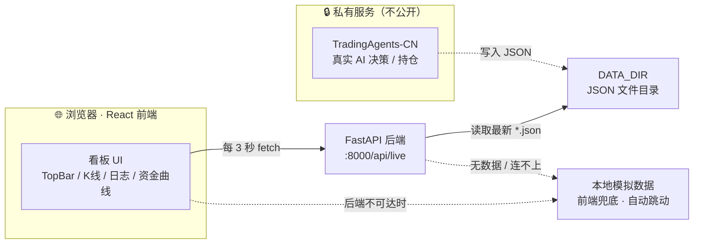

# moreb1essed · AI 多智能体量化交易看板

<p align="center">
  
  
  
  
  
  
</p>

> 一个赛博朋克「粉黑萌系」风格的多智能体（Multi-Agent）AI 量化交易可视化看板。
> 顶部 6 个圆脸机器人 Agent 监控、K 线主图、实时决策日志、资金曲线——全部数据可本地模拟，也可对接你自己的后端。

## ✨ 特性

- 🎨 粉黑萌系赛博朋克 UI（深色卡片 + 粉色底层 + 霓虹色 + 圆脸机器人）
- 🤖 6 个 AI Agent 卡片，**表情随行情联动**：赚钱兴奋、亏钱哭泣、空头偷笑
- 📈 `lightweight-charts` K 线主图 + `recharts` 资金曲线
- 🧪 **零配置即可运行**：内置本地模拟数据，无需任何后端
- 🔌 可选对接真实后端：FastAPI 读取 JSON 提供 `/api/live`
- 📜 底部跑马灯 + 系统彩蛋日志，增添趣味

## 🖼️ 截图

> 把你的看板截图放到 `docs/` 下，并在这里引用：
>
> ``

## 🛠 技术栈

| 层 | 技术 |
| --- | --- |
| 前端 | React 18 + Vite + Tailwind CSS v4 |
| 图表 | lightweight-charts v5（K 线）、recharts（资金曲线） |
| 后端（可选） | FastAPI（读取本地 JSON，提供实时接口） |

## 📁 项目结构

```text
ai-trading-dashboard/
├── backend/
│   ├── server.py          # FastAPI：读取最新 JSON，提供 /api/live
│   ├── requirements.txt   # 后端依赖（fastapi / uvicorn）
│   └── data/
│       └── sample.json    # 示例数据（已提交；真实输出被 .gitignore 忽略）
├── src/
│   ├── App.jsx            # 顶层布局 + 每 3 秒拉取实时数据
│   ├── main.jsx
│   ├── index.css          # Tailwind v4 主题（粉色世界）
│   ├── components/
│   │   ├── TopBar.jsx        # 6 个机器人 Agent 卡片
│   │   ├── KLineChart.jsx    # K 线主图（lightweight-charts）
│   │   ├── AgentLog.jsx      # AI 决策日志（自动滚动）
│   │   ├── PortfolioCurve.jsx# 资金曲线（recharts 面积图）
│   │   ├── TickerStrip.jsx   # 底部跑马灯
│   │   └── RobotAvatar.jsx   # 圆脸机器人头像（会眨眼/随行情变表情）
│   └── lib/
│       └── mockData.js       # 本地模拟数据（后端不可达时的兜底）
├── index.html
├── vite.config.js
├── package.json
├── README.md
└── LICENSE
```

## 🏗️ 系统架构（数据流）



> 关键点：前端与后端解耦，通过 `/api/live` 这一个 JSON 接口通信。即便私有后端不开，
> 前端也会自动切到本地模拟数据，保证看板永远"有东西在动"。

## 🚀 快速开始

### 1. 前端（必选）

```bash
cd ai-trading-dashboard
npm install
npm run dev
# 浏览器打开 http://localhost:5173
```

> 没有后端也能跑：前端会自动使用本地模拟数据并实时跳动。

### 2. 后端（可选，想要真实数据时才用）

```bash
pip3 install -r backend/requirements.txt
python3 backend/server.py
# 接口地址：http://localhost:8000/api/live
```

后端默认读取 `backend/data/` 目录下最新的 `*.json`（已附带示例 `sample.json`）。

## 📡 数据接口契约（`/api/live`）

返回一个 JSON 对象，包含以下四部分（可只返回子集，缺失字段前端会自动跳过）：

```json
{
  "candles": [
    { "time": 1718500000, "open": 42000, "high": 42120, "low": 41980, "close": 42080, "volume": 210 }
  ],
  "agents": [
    { "id": "master", "name": "主控 AGENT", "en": "MASTER", "color": "#22D3EE", "face": "serious", "status": "working", "lastSay": "全局调度中", "lastActive": "15:30:01" }
  ],
  "logs": [
    { "id": "1", "seq": 1, "ts": "15:30:01", "agent": { "en": "MASTER", "color": "#22D3EE" }, "thought": "开始本轮协同决策", "decision": { "action": "BUY", "confidence": 0.78, "size": 0.05 } }
  ],
  "equity": [
    { "time": "15:20:00", "equity": 1000000 }
  ]
}
```

字段说明：

- `candles.time`：Unix **秒**（数字），K 线按此排序。
- `agents.face` 取值：`happy` / `serious` / `sleepy` / `excited` / `cool` / `curious` / `sad` / `cry`。
- `logs.decision.action` 取值：`BUY` / `SELL` / `ADD` / `REDUCE` / `CLOSE` / `HOLD` / `CHILL`。

## 🔌 接入你自己的后端

把后端指向你真实数据的输出目录即可：

```bash
DATA_DIR=/你的/真实/数据/目录 python3 backend/server.py
```

脚本会自动读取该目录下**最近修改**的那个 `.json` 文件。如果你的 JSON 字段名不同，只需在 `backend/server.py` 里加一段映射即可。

## 🔒 数据安全与隐私

- 本项目**不含任何 API Key、密钥或真实交易数据**，可直接公开。
- `backend/data/` 目录下**只提交了示例数据 `sample.json`**；你的真实输出会被 `.gitignore` 忽略，**绝不会进入仓库**。
- 请不要把 `.env`、私钥、交易所密钥等加入版本库。提交前用 `git status` 确认没有敏感文件被暂存。
- 真实后端（例如你的 TradingAgents-CN）是私有服务，本仓库**不提供**真实交易接口，仅提供前端与示例接口。

## 📄 许可证

[MIT](LICENSE) © 2026 moreb1essed

> 如需把版权持有者改为你自己的名字/昵称，直接改 `LICENSE` 第一行即可。

## ⚠️ 免责声明

本项目仅用于技术演示与学习，所有数据均为模拟或示例，**不构成任何投资建议**。
